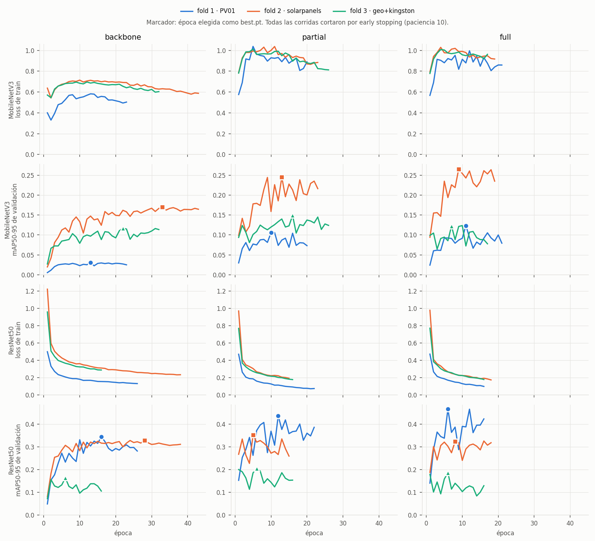
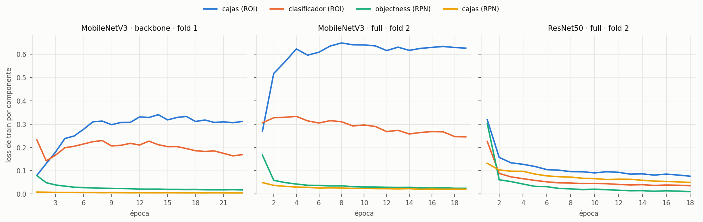

# Resultados de Faster R-CNN

Son las 18 corridas de `entrenamiento_colab.ipynb`: 2 arquitecturas, 3 estrategias de congelamiento y 3 folds. Se entrenó en Colab con una Tesla T4 (torch 2.11, torchvision 0.26) y no falló ninguna. Tardaron 2 h 19 min en total. La receta está en el [README](README.md). Los números salen de `summary.csv`, `fold_metrics.csv`, `classification_metrics.csv` y `experiments.csv`, más el log por época del notebook.

## Detección

mAP50-95 por fold con el `best.pt` de cada corrida. La métrica principal es el promedio macro de los tres folds.

| Arquitectura | Estrategia | Fold 1 (PV01) | Fold 2 (solarpanels_hd) | Fold 3 (geo_unknown + kingston) | **Macro** |
|---|---|---|---|---|---|
| MobileNetV3 | `backbone` | 0.031 | 0.170 | 0.117 | 0.106 |
| MobileNetV3 | `full` | 0.124 | 0.266 | 0.123 | 0.171 |
| MobileNetV3 | `partial` | 0.106 | 0.245 | 0.149 | 0.167 |
| ResNet50 | `backbone` | 0.344 | 0.328 | 0.163 | 0.279 |
| ResNet50 | `full` | **0.466** | 0.323 | 0.187 | 0.325 |
| ResNet50 | `partial` | 0.436 | **0.351** | **0.204** | **0.331** |

Promedio macro de las otras métricas (P y R en el punto de F1 máximo, IoU 0.5):

| Arquitectura | Estrategia | mAP50 | Precisión | Recall | mAP50-95 |
|---|---|---|---|---|---|
| MobileNetV3 | `backbone` | 0.255 | 0.508 | 0.270 | 0.106 |
| MobileNetV3 | `full` | 0.383 | 0.671 | 0.379 | 0.171 |
| MobileNetV3 | `partial` | 0.360 | 0.556 | 0.387 | 0.167 |
| ResNet50 | `backbone` | 0.560 | 0.727 | 0.525 | 0.279 |
| ResNet50 | `full` | 0.568 | 0.719 | 0.529 | 0.325 |
| ResNet50 | `partial` | 0.566 | 0.759 | 0.534 | 0.331 |

### Qué se ve

- **La arquitectura pesa más que el congelamiento.** Con la misma estrategia, la ResNet50 duplica el mAP50-95 de la MobileNet. La diferencia es más grande en PV01 (0.47 contra 0.12), la fuente con más cajas por imagen y más cajas chicas. Coincide con lo previsto en el README: a 256 px, el FPN de la MobileNet de torchvision solo ve una grilla de 8 × 8 y sus anclas más chicas son de 32 px.
- **Congelar todo el extractor (`backbone`) es lo peor en las dos redes.** Las features de COCO sirven, pero hay que adaptarlas a la vista aérea. En la ResNet50 cuesta 0.05 de mAP50-95 macro; en la MobileNet, 0.06.
- **`full` y `partial` empatan.** En la ResNet50 la diferencia es 0.006 y en la MobileNet 0.004. Las dos son mucho menores que el ruido entre épocas (ver *Dinámica del entrenamiento*). No se puede elegir una sobre la otra con estos datos. En la MobileNet era esperable, porque `partial` congela solo 8 072 parámetros.
- **El fold 3 es el más difícil en los seis casos.** No pasa de 0.20, y además tiene solo 79 cajas, así que su mAP es poco preciso.
- **Hacia mAP50-95 se pierde más que hacia mAP50.** La ResNet50 llega a 0.57 de mAP50 macro, pero cae a 0.33 en mAP50-95: encuentra los paneles, pero las cajas no ajustan bien al borde. En imágenes de 256 px con paneles de pocos píxeles, un píxel de error ya baja mucho el IoU.

### Fold 3 por fuente

| Arquitectura | Estrategia | geo_unknown mAP50-95 (13 cajas) | kingston mAP50-95 (66 cajas) | kingston2: imágenes con FP (de 28) | kingston2: cajas FP |
|---|---|---|---|---|---|
| MobileNetV3 | `backbone` | 0.196 | 0.109 | 5 | 5 |
| MobileNetV3 | `full` | 0.182 | 0.116 | 4 | 4 |
| MobileNetV3 | `partial` | 0.301 | 0.131 | 9 | 9 |
| ResNet50 | `backbone` | 0.178 | 0.189 | 19 | 31 |
| ResNet50 | `full` | 0.331 | 0.182 | 15 | 25 |
| ResNet50 | `partial` | 0.384 | 0.182 | 23 | 56 |

kingston2 no tiene paneles, así que cualquier detección con confianza ≥ 0.25 es un falso positivo. **La ResNet50 detecta más pero también inventa más**: dispara en 15 a 23 de las 28 imágenes vacías, mientras que la MobileNet lo hace en 4 a 9. Lo de geo_unknown sale de solo 13 cajas, así que sus diferencias entre estrategias no son confiables.

## Detector como clasificador

Cada imagen recibe como score su confianza máxima de detección. F1 macro de "tiene paneles / no tiene":

| Arquitectura | Estrategia | Fold 1 fábrica | Fold 2 fábrica | Fold 3 fábrica | Fold 2 calibrado | Fold 3 calibrado |
|---|---|---|---|---|---|---|
| Referencia trivial (todo positivo) | | 0.499 | 0.473 | 0.293 | 0.473 | 0.293 |
| MobileNetV3 | `backbone` | 0.420 | 0.598 | **0.789** | 0.657 | **0.824** |
| MobileNetV3 | `full` | 0.487 | 0.650 | 0.774 | **0.753** | 0.802 |
| MobileNetV3 | `partial` | 0.532 | 0.633 | 0.719 | 0.750 | 0.774 |
| ResNet50 | `backbone` | 0.498 | **0.711** | 0.539 | 0.717 | 0.776 |
| ResNet50 | `full` | 0.586 | 0.675 | 0.600 | 0.723 | 0.735 |
| ResNet50 | `partial` | **0.749** | 0.557 | 0.465 | 0.698 | 0.757 |

*Fábrica* es umbral 0.25. *Calibrado* es el umbral que maximiza el F1 macro sobre la misma validación: es un diagnóstico, no una estimación.

- **El fold 1 no sirve para medir clasificación.** PV01 tiene 477 imágenes con paneles y una sola sin. El F1 macro depende de si esa única imagen se acierta. Decir siempre "sí" ya da 99.8 % de accuracy.
- **En los folds 2 y 3 todos los modelos superan la referencia trivial**, también con el umbral de fábrica.
- **El mejor detector no es el mejor clasificador.** En el fold 3, con umbral 0.25, la ResNet50 `partial` acierta 40 de 44 imágenes con paneles, pero marca 49 de las 62 vacías (TP 40, FP 49, FN 4, TN 13). La MobileNet `backbone` se equivoca menos con las vacías (TP 35, FP 13, FN 9, TN 49). Es el mismo efecto que en kingston2.
- **El problema de la ResNet50 es el umbral, no el ranking.** Con el umbral calibrado, su F1 macro en el fold 3 sube de 0.47–0.60 a 0.74–0.78: los scores sí separan las clases. Sus confianzas son más altas que las de la MobileNet, y 0.25 le queda bajo. Para usarla como clasificador habría que elegir el umbral en un conjunto aparte, no en esta validación.

## Dinámica del entrenamiento

| Arquitectura | Estrategia | Épocas corridas (f1 / f2 / f3) | Mejor época (f1 / f2 / f3) | Minutos (3 folds) |
|---|---|---|---|---|
| MobileNetV3 | `backbone` | 23 / 43 / 32 | 13 / 33 / 22 | 23 |
| MobileNetV3 | `full` | 21 / 19 / 17 | 11 / 9 / 7 | 15 |
| MobileNetV3 | `partial` | 20 / 23 / 26 | 10 / 13 / 16 | 17 |
| ResNet50 | `backbone` | 26 / 38 / 16 | 16 / 28 / 6 | 32 |
| ResNet50 | `full` | 16 / 18 / 16 | 6 / 8 / 6 | 25 |
| ResNet50 | `partial` | 22 / 15 / 16 | 12 / 5 / 6 | 26 |

- **Todas pararon por early stopping antes de la época 50.** El tope de épocas no limitó a ninguna. La más larga fue la MobileNet `backbone` del fold 2, con 43.
- **Las estrategias con más parámetros entrenables llegan antes a su mejor época.** Con `backbone`, que solo entrena FPN, RPN y cabeza, tardan más en llegar a su techo.
- **El mAP de validación oscila mucho entre épocas.** En la ResNet50 `full` del fold 1 da 0.466 en la época 6, 0.287 en la 9 y 0.465 en la 12. La variación típica de una época a la siguiente es de 0.02 a 0.05 en la ResNet50 y de 0.01 a 0.03 en la MobileNet.
- **El learning rate casi nunca llegó a bajar.** El coseno está pensado para 50 épocas y las corridas pararon entre la 15 y la 26. En 16 de las 18, el learning rate todavía estaba entre el 30 % y el 80 % del máximo. Ningún modelo pasó por la fase de learning rate bajo, que es la que suele estabilizar el mAP.

### Curvas de entrenamiento

Las filas son las dos arquitecturas (loss de train y mAP de validación de cada una). Las columnas son las estrategias y hay una línea por fold. El marcador indica la época que quedó como `best.pt`.

No hay curva de loss de validación. El Faster R-CNN de torchvision, en modo evaluación, devuelve detecciones y no pérdidas, así que cada época se valida con mAP. YOLO sí informa loss de validación, y al compararlos hay que tenerlo en cuenta.

- **ResNet50: ajusta el train, pero la validación se estanca.** La loss de train baja todo el tiempo, de ~1.0 a 0.1–0.2. El mAP de validación deja de mejorar hacia la época 5 y después oscila; en el fold 3 incluso cae desde la época 6. Es sobreajuste a las fuentes de train, o la brecha de dominio entre fuentes. Encaja con que el early stopping cortara temprano.
- **MobileNetV3: la loss de train sube.** Pasa de ~0.6 a ~1.0 al terminar el warmup y queda ahí, en las tres estrategias, mientras el mAP de validación sí mejora.

### Por qué sube la loss de la MobileNet

La loss total de Faster R-CNN es la suma de cuatro componentes. Se miraron en tres corridas:

| Corrida | Cajas ROI (época 1 → última) | Clasificador ROI | Objectness RPN | Cajas RPN |
|---|---|---|---|---|
| MobileNetV3 `full`, fold 2 | **0.27 → 0.63** | 0.31 → 0.25 | 0.17 → 0.03 | 0.05 → 0.02 |
| MobileNetV3 `backbone`, fold 1 | **0.08 → 0.31** | 0.23 → 0.17 | 0.08 → 0.02 | 0.01 → 0.005 |
| ResNet50 `full`, fold 2 | 0.32 → 0.08 | 0.23 → 0.04 | 0.30 → 0.01 | 0.13 → 0.05 |

- **Sube un solo componente, la regresión de cajas del cabezal ROI.** Los otros tres bajan con normalidad. No es inestabilidad por un learning rate alto: en ese caso subirían o saltarían todos. La suba además empieza en la época 2, cuando el warmup todavía tiene el learning rate en un tercio del máximo.
- **La suba es un efecto de cómo se calcula esa loss.** torchvision suma el error de cajas solo sobre las propuestas que caen en un panel, pero lo divide por el total de propuestas muestreadas. Al principio la RPN de la MobileNet casi no genera propuestas positivas y la loss sale baja. A medida que aprende aparecen más, y la loss sube aunque el modelo mejore.
- **Lo que importa es dónde se estabiliza: la MobileNet subajusta.** Su regresión de cajas queda en 0.63, contra 0.08 de la ResNet50: no logra ajustar las cajas ni siquiera en el train. Con features de stride 32 (la grilla de 8 × 8) no tiene resolución para ubicar con precisión paneles de pocos píxeles. Es coherente con su mAP50-95 bajo.

Las dos arquitecturas fallan de forma opuesta. **La MobileNetV3 subajusta por falta de resolución espacial**, un límite de la arquitectura y no de la receta. **La ResNet50 ajusta el train pero no generaliza a la fuente nueva.** Que un learning rate más bajo mejore algo a la MobileNet no se puede descartar sin re-entrenarla, pero las curvas no muestran señales de que ese sea el problema.

## Intentos de mejora

Sobre la mejor configuración, ResNet50 `partial`, se probaron dos variantes motivadas por el análisis anterior (`entrenamiento_anclas_colab.ipynb`, detalles en el README):

- **anclas**: anclas ajustadas a las cajas del dataset (16 a 256 px, proporciones de 0.25 a 4) y 20 épocas sin early stopping, para que el learning rate llegue a 0.
- **aumento**: lo mismo, más rotaciones de 90° y cambios de brillo, contraste, saturación y tono.

La ablación (anclas de COCO con 20 épocas) no se corrió. Por eso, *anclas − base* mezcla el efecto de las anclas con el de las épocas.

| Variante | mAP50-95 f1 / f2 / f3 | **mAP50-95 macro** | mAP50 macro | Precisión / recall macro | Mejor época f1 / f2 / f3 |
|---|---|---|---|---|---|
| base | 0.436 / 0.351 / 0.204 | 0.331 | 0.566 | 0.759 / 0.534 | 12 / 5 / 6 |
| anclas | 0.405 / 0.364 / 0.184 | 0.318 | 0.559 | 0.816 / 0.530 | 12 / 5 / 13 |
| aumento | 0.411 / 0.372 / 0.211 | **0.332** | **0.595** | 0.797 / 0.559 | 17 / 5 / 5 |

Falsos positivos y detector como clasificador (F1 macro con umbral de fábrica 0.25 y calibrado):

| Variante | kingston2: imágenes / cajas FP | F1 macro fold 2 (fábrica / calibrado) | F1 macro fold 3 (fábrica / calibrado) |
|---|---|---|---|
| base | 23 / 56 | 0.557 / 0.698 | 0.465 / 0.757 |
| anclas | **28 / 98** | 0.504 / 0.758 | **0.318** / 0.790 |
| aumento | 20 / 66 | **0.608** / 0.767 | **0.521** / 0.778 |

Lo que se ve:

- **Ninguna variante mejora el mAP50-95 más allá del ruido.** Aumento empata con la base (0.332 contra 0.331) y anclas queda 0.013 abajo. El fold 2 mejora en las dos (+0.013 y +0.021), pero el fold 1 empeora (−0.025 a −0.031), justo el de PV01, para el que estaban pensadas las anclas. Una explicación probable: el fold 1 entrena con solo 579 cajas, y con las anclas nuevas las capas de salida de la RPN arrancan de cero. Con tan pocos ejemplos y 20 épocas no llegan a aprender bien.
- **El aumento mejora el mAP50: 0.595 contra 0.566.** Suben el fold 2 (+0.044) y el fold 3 (+0.058). Encuentra más paneles en las fuentes nuevas, pero sin ajustar mejor las cajas, así que el mAP50-95 no se mueve.
- **Las anclas solas empeoran los falsos positivos.** Con cinco veces más anclas por posición, y anclas de 16 px, el modelo detecta "paneles" en las 28 imágenes vacías de kingston2 (98 cajas). Con el umbral de fábrica, en el fold 3 el clasificador queda casi igual que decir siempre "sí" (0.318 contra 0.293). El aumento corrige buena parte de eso (20 imágenes, 66 cajas) y es la mejor variante como clasificador con el umbral de fábrica.
- **El sobreajuste a las fuentes de train sigue.** En el fold 3 con aumento, el mejor mAP50-95 aparece en la época 5 (0.211) y baja hasta 0.159 en la época 20, aunque la loss de train sigue bajando. Terminar con el learning rate bajo no lo evita.

En resumen: **el límite no está en las anclas, en el learning rate ni en el aumento, sino en la brecha de dominio entre fuentes.** El aumento es el único cambio con algún beneficio: mejor mAP50 y mejor detector como clasificador, con el mismo mAP50-95. Para confirmarlo harían falta varias semillas.

## Limitaciones

- **`best.pt` es optimista.** Se elige la mejor época sobre la misma validación que después se informa, y con esa oscilación el máximo incluye algo de suerte. YOLO elige `best.pt` de la misma forma, así que la comparación entre familias es pareja en esto. Aun así, las diferencias chicas no se pueden leer como reales.
- **Hay una sola semilla por combinación.** No hay intervalos de confianza. Diferencias menores a unos 0.03 de mAP50-95 no son concluyentes.
- **Las recetas de entrenamiento son distintas.** Esta usa la receta estándar de torchvision (SGD, 50 épocas, patience 10, batch 8, volteos). YOLO usa la de Ultralytics (AdamW, 100 épocas, patience 15, más aumento de datos). Se compara cada familia con su receta habitual, no con una receta idéntica.
- **El mAP no es exactamente el mismo.** El de Ultralytics empareja distinto que el de COCO, así que una diferencia de un punto con YOLO no es concluyente.

## Conclusiones para el informe

1. Dentro de la familia R-CNN, la mejor configuración es **ResNet50 FPN con `partial` o `full`**, alrededor de 0.33 de mAP50-95 macro. Entre las dos no hay ganador claro.
2. La **MobileNetV3 FPN de torchvision no sirve a 256 px**: su FPN no tiene resolución para paneles chicos. Subajusta: no logra ajustar las cajas ni siquiera en el train.
3. **Congelar todo el extractor empeora** en las dos redes. Ajustar las features de COCO vale la pena.
4. **Generalizar a fuentes nuevas sigue siendo difícil**: el fold 3 no pasa de 0.20. Y la ResNet50 genera muchos falsos positivos en imágenes sin paneles, salvo que se le suba el umbral.
5. **Las mejoras probadas no superan a la base en mAP50-95**: ni las anclas ajustadas, ni las 20 épocas, ni el aumento de datos. El aumento sube el mAP50 (0.595 contra 0.566) y mejora el detector como clasificador; las anclas solas aumentan los falsos positivos. El cuello de botella es la brecha de dominio entre fuentes.
